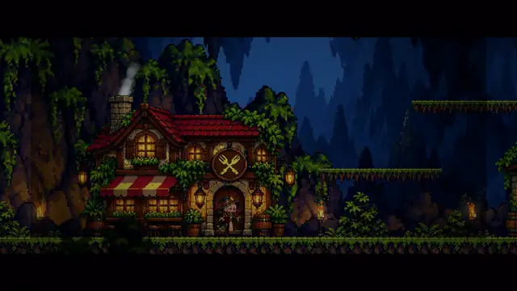
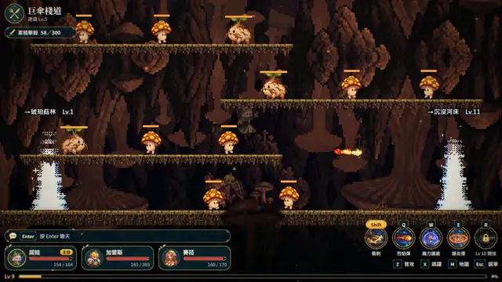
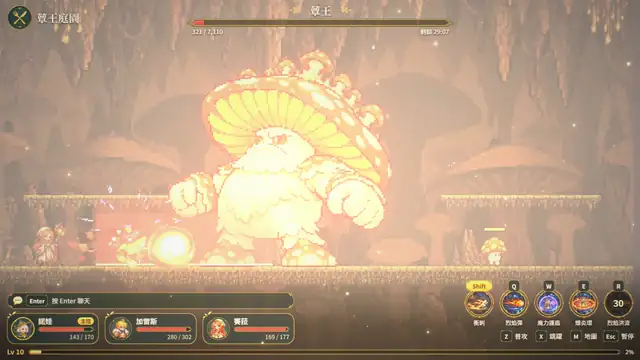
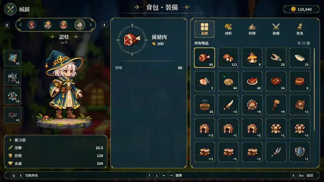

<h1 align="center">Hi, I'm Tack 👋</h1>

  I build tools for <b>AI image generation</b>, <b>AI coding agents</b>, and <b>creative workflow automation</b>. 
  Mostly things I personally need and can't find elsewhere.

  

---

## ⭐ Latest Project

  

<h3 align="center">勇者和他的深夜食堂</h3>

  <b>Fight through the dungeon, then cook what you hunted.</b> 
  An online 2D pixel-art browser game: lead a party of four through the dungeon, 
  then turn the loot into dishes at the restaurant you run back in town.

<table align="center">
  <tr>
    <td align="center" width="50%"> 🏘️ Town — restaurant, blacksmith, dungeon gate</td>
    <td align="center" width="50%"> ⚔️ Grind 300 kills to open the Boss Portal</td>
  </tr>
  <tr>
    <td align="center" width="50%"> 🍄 Boss fight — take down the Mushroom King</td>
    <td align="center" width="50%"> 🍲 Gear up, cook, and stock the menu</td>
  </tr>
</table>

- 🗺️ **Side-scrolling dungeon maps** — multi-layer platforms, endless mob refills, a world map that clears its fog as you explore
- 🛡️ **Party of four** — swordsman, knight, cleric and mage; control one, AI teammates follow and fight
- 👹 **Timed boss runs** — 30-minute boss maps with server-side clear settlement and loot
- 🍳 **Your own restaurant** — cook dungeon materials into dishes, place furniture, serve customers for gold
- 📤 **Dispatch** — send the party out while you're away and collect the haul later
- ⚙️ **Stack** — Phaser 4 + TypeScript + Vite, Cloudflare Workers + D1, Better Auth

  <a href="https://bladefeast.com/"><b>🎮 Play at bladefeast.com</b></a>
  &nbsp;·&nbsp;
  <a href="https://github.com/tackcrypto1031/Dungeon-restaurant"><b>📂 Repository</b></a>

Previous project: 🏝️ <b>開工吧！社畜人生！ Kaigong Agent</b>

 

  

  A Windows / macOS desktop app that manages your AI coding agents like a city-building game. 
  <a href="https://github.com/tackcrypto1031/kaigong-agent">Repository</a> · <a href="https://github.com/tackcrypto1031/kaigong-agent/releases/latest">Download</a>

---

## 🎨 ComfyUI Tools

| Project | Description |
| --- | --- |
| 🛠️ [**tk_comfyui_start_tool**](https://github.com/tackcrypto1031/tk_comfyui_start_tool) | Manage multiple isolated ComfyUI installs with their own plugins, Python and CUDA — plus conflict analysis and snapshot rollback |
| 🖥️ [**comfyui_monitor-to-notion**](https://github.com/tackcrypto1031/comfyui_monitor-to-notion) | Monitor multiple ComfyUI instances in real time and sync their status to Notion |
| 🍌 [**tk_comfyui_tool**](https://github.com/tackcrypto1031/tk_comfyui_tool) | Wrap complex node graphs into clean, user-friendly modal interfaces |

## 🧩 ComfyUI Custom Nodes

| Project | Description |
| --- | --- |
| ✂️ [**tk_seethrough**](https://github.com/tackcrypto1031/tk_seethrough) | AI character layer separation with auto-fill, PSD export and Spine 2D export |
| 🔍 [**tk_comfyui_imageVL**](https://github.com/tackcrypto1031/tk_comfyui_imageVL) | Batch image processing and VLM interrogation with Qwen-VL |
| 💡 [**tk_comfyui_view_and_light**](https://github.com/tackcrypto1031/tk_comfyui_view_and_light) | Interactive 3D camera and lighting widget that auto-generates prompts |
| 📐 [**tk_comfyui_SimpleSize**](https://github.com/tackcrypto1031/tk_comfyui_SimpleSize) | Model-aware resolution presets with built-in latent output |
| 🎭 [**tk_comfyui_img2mask**](https://github.com/tackcrypto1031/tk_comfyui_img2mask) | Extract the alpha channel of RGBA images as masks |

## 🧰 Other Projects

| Project | Description |
| --- | --- |
| 📡 [**local2other**](https://github.com/tackcrypto1031/local2other) | Electron SSH/SCP tool for sending local files to multiple hosts at once |
| 🃏 [**FF14_cardpvp**](https://github.com/tackcrypto1031/FF14_cardpvp) | FF14 Triple Triad simulator and solver with Minimax AI |

---

  <picture>
    <source media="(prefers-color-scheme: dark)" srcset="https://raw.githubusercontent.com/tackcrypto1031/tackcrypto1031/output/snake-dark.svg">
    
  </picture>

